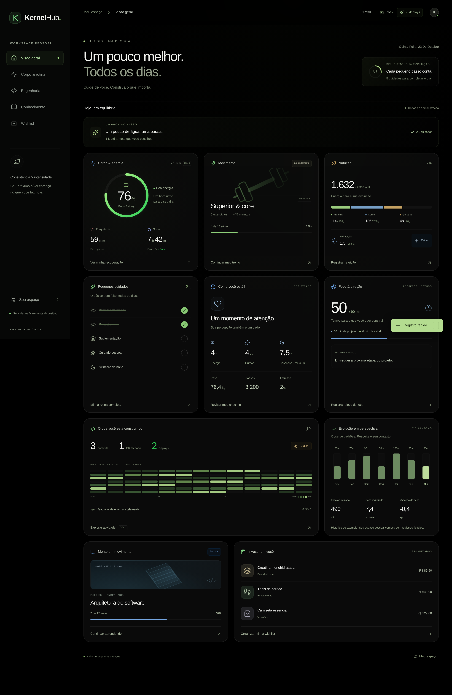
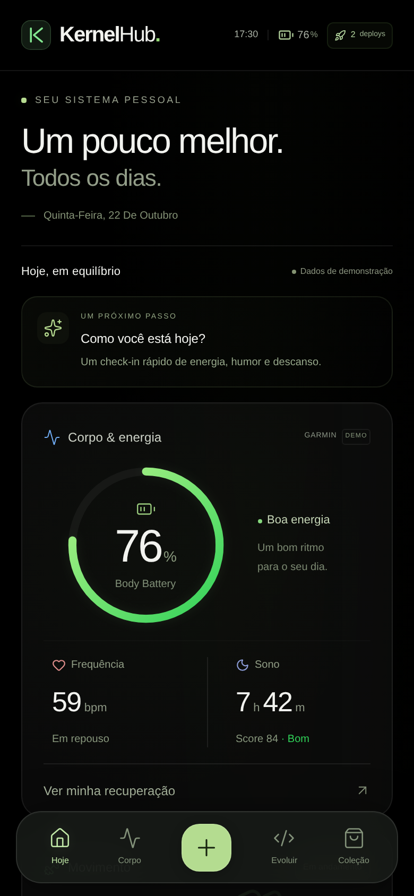
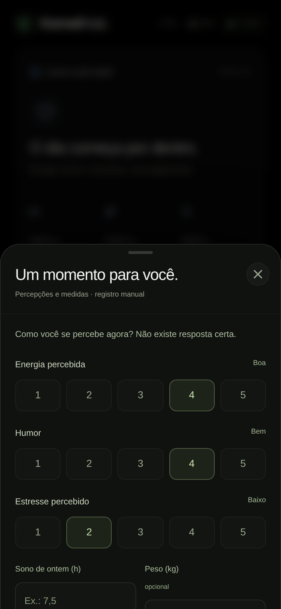

# KernelHub

**Seu sistema pessoal. Um pouco melhor, todos os dias.**

KernelHub reúne corpo, bem-estar, rotina, carreira e aprendizado em um espaço diário pensado primeiro para iPhone. A pergunta central é simples: **como estou, o que merece atenção e o que avancei hoje?**



> As imagens mostram a demonstração, com dados fictícios identificados na interface. Garmin e GitHub ainda não estão conectados. O aplicativo não faz diagnóstico nem prescreve metas.

## Um produto para usar, não apenas observar

O fluxo é **consultar → agir → registrar → seguir o dia**. Navegação inferior, registros rápidos e painéis próximos ao polegar deixam as ações frequentes a poucos toques. O fundo OLED, a tipografia de sistema, as superfícies discretas e as animações com mola mantêm a linguagem visual consistente.

<table>
  <tr>
    <td align="center"><br /><strong>Contexto para hoje</strong></td>
    <td align="center"><br /><strong>Uma pausa para se perceber</strong></td>
  </tr>
</table>

## O que já funciona

| Área                    | Registros e utilidade                                                                                                                                                         |
| ----------------------- | ----------------------------------------------------------------------------------------------------------------------------------------------------------------------------- |
| **Corpo e recuperação** | Telemetria demonstrativa identificada; check-in manual de sono, energia, humor, estresse, peso e passos opcionais.                                                            |
| **Treino e corrida**    | Conclusão e correção de séries; registro de distância; estados de planejado, em andamento e concluído. A ficha inicial é um exemplo.                                          |
| **Alimentação**         | Refeições por macronutrientes, calorias derivadas e água com ajuste reversível. Metas pessoais editáveis.                                                                     |
| **Cuidado e aparência** | Rotina de skincare, proteção solar, cuidados pessoais e suplementação; sem notas de aparência ou recomendações de dosagem.                                                    |
| **Carreira e projetos** | Blocos concluídos de foco com tempo e resultado; tempo de projeto separado de estudo. Commits, PRs e deploys demonstrativos permanecem distintos.                             |
| **Conhecimento**        | Progresso de aulas, correção de conclusão e insights escritos. As duas trilhas iniciais são exemplos.                                                                         |
| **Estilo de vida**      | Wishlist com objetivo, categoria, preço, prioridade, aquisição reversível e remoção confirmada.                                                                               |
| **Evolução**            | Panorama de sete dias com foco acumulado, sono informado e variação de peso quando existem ao menos duas medidas. Lacunas continuam vazias.                                   |
| **Dados pessoais**      | Exportação e restauração de backup JSON, validação antes de substituir dados, migração da primeira versão e preservação de registros incompatíveis em arquivo de recuperação. |

### Demonstração e espaço pessoal

O primeiro acesso abre a demonstração para explorar os módulos. Em **Meu espaço → Dados & privacidade → Criar meu espaço pessoal**, uma confirmação permite começar sem registros fictícios. Exporte um backup antes se quiser preservar o que registrou na demonstração.

No espaço pessoal, água, alimentação, séries, foco, cursos e wishlist começam vazios. As integrações sem conexão mostram indisponibilidade, nunca números inventados. A cada dia, os registros diários são renovados e um resumo do dia anterior é preservado. Metas, cursos, insights e aquisições continuam disponíveis.

## Desenvolvimento local

Requisitos: **Node.js 22.18+** (validado com 24.19) e npm. O protótipo não exige contas, banco ou credenciais.

```bash
npm ci
npm run dev
```

Para executar a versão de produção:

```bash
npm run build
npm run start
```

No ambiente cloud, use o checkout existente em `/workspace/KernelHub`; cada tarefa já é isolada e não precisa de um novo worktree. Quando o cache padrão não for gravável, use `npm --cache /workspace/.npm-cache ci`.

## GitHub, verificações e publicação

- [Quality](.github/workflows/ci.yml) instala pelo lockfile, executa os testes de domínio e interface, compila e verifica a exportação estática com uso offline.
- [Publish GitHub Pages](.github/workflows/pages.yml) prepara o site estático e publica em Pages nos pushes para `main` ou por execução manual. As Actions estão fixadas por SHA.
- Antes do primeiro deploy, um administrador precisa selecionar **Settings → Pages → Build and deployment → Source: GitHub Actions** no repositório. Depois, execute novamente o workflow de publicação. O token automático de Actions não habilita sozinho o serviço Pages em um repositório novo.
- A URL publicada deve ser consultada na saída do job `deployment` ou no ambiente `github-pages`. A presença do workflow no repositório não comprova um site online.

Para reproduzir o artefato Pages e sua verificação local:

```bash
npm run build:pages
npm run test:pages
```

O resultado fica em `out/`. O caminho padrão é `/KernelHub`; `NEXT_PUBLIC_BASE_PATH` permite alterá-lo. Manifesto, ícones, assets e service worker usam o mesmo caminho. A exportação estática substitui o build em `.next`; execute `npm run build` antes de voltar a `npm run start`.

### Instalar como PWA

Abra a versão publicada em **HTTPS**, no Safari do iPhone, e escolha **Compartilhar → Adicionar à Tela de Início**. Depois da primeira visita online concluída, o shell e os registros locais continuam disponíveis offline. O service worker fica desativado durante `npm run dev`.

O app respeita as áreas seguras, mantém zoom de acessibilidade e reduz animações quando solicitado pelo sistema. `navigator.vibrate` é opcional: Safari no iPhone não oferece essa API, e toda ação tem feedback visual.

## Verificação

```bash
npm run typecheck
npm run test:unit
npm run build
npm test
npm run build:pages
npm run test:pages
```

Playwright cobre viewport iPhone e desktop, integridade dos registros, check-in, foco, metas, backups, modo pessoal, alimentação, hábitos, treino, wishlist, painéis, acessibilidade automatizada e offline. Os testes usam Chromium do sistema quando disponível ou o navegador instalado pelo Playwright. Em outras máquinas, execute `npx playwright install --with-deps chromium`; `PLAYWRIGHT_CHROMIUM_PATH` permite indicar outro executável.

Emulação não substitui Safari físico: instalação, teclado, safe areas, VoiceOver e gestos de toque precisam de validação no iPhone antes de um lançamento público.

## Arquitetura

| Camada                                                      | Local                                   |
| ----------------------------------------------------------- | --------------------------------------- |
| Next.js App Router, React 19, shell e metadados             | `app/`                                  |
| Tokens OLED, Tailwind, estilos responsivos e acessibilidade | `tailwind.config.ts`, `app/globals.css` |
| Contratos de dados e ações discriminadas                    | `types/kernel.ts`                       |
| Fixtures, cálculos, histórico e próximo passo contextual    | `lib/mock-engine.ts`, `lib/metrics.ts`  |
| Reducer, validação Zod, migração e persistência             | `lib/state.ts`, `lib/use-kernel.ts`     |
| Módulos, registros e componentes de interação               | `components/`                           |
| Cache restrito ao caminho do app e assets públicos          | `public/sw.js`                          |
| Exportação e verificação de Pages                           | `scripts/`                              |

## Privacidade e limites

Os registros ficam no navegador, em `localStorage`, sem sincronização ou backup automático. Esse armazenamento **não é criptografado pelo aplicativo**. Apagar os dados do navegador remove os registros; mantenha um backup fora dele. O histórico comporta 90 resumos diários, 200 eventos recentes e 500 insights. A importação aceita JSON validado de até 2 MB e pede confirmação antes de substituir registros.

Garmin e GitHub reais dependem de autorização e de uma camada de servidor. Nenhuma senha, token ou dado pessoal deve ser colocado no frontend, nas imagens do README ou no repositório. Publicar no GitHub não publica os registros locais de quem usa o app.

O nome KernelHub e o domínio `KernelHub.dev` continuam como identidade de trabalho; disponibilidade de domínio e marca não foi validada.

Consulte o [conceito e a arquitetura de produto](docs/PRODUCT.md), a [auditoria de UX e decisões desta revisão](docs/UX-REVIEW.md) e o [registro de evolução](CHANGELOG.md).
