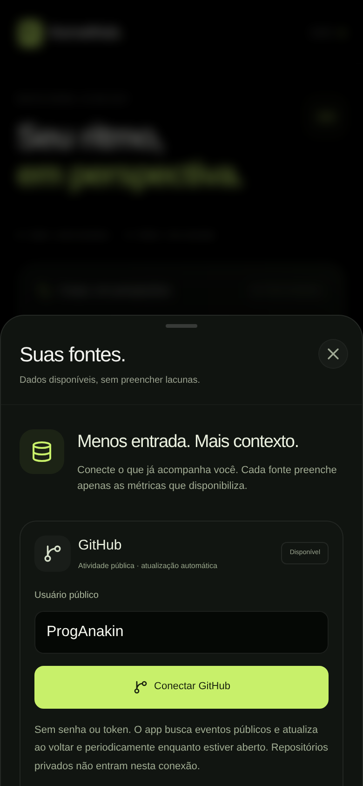
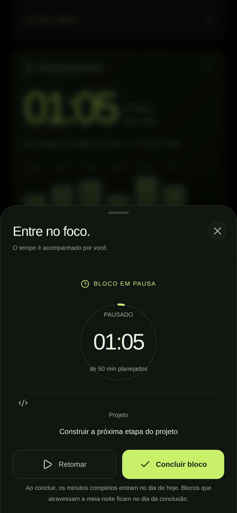

# KernelHub

**Seu ritmo, em perspectiva.**

Versão 0.4 · um panorama diário para reunir dados de corpo, rotina, aprendizado e trabalho técnico, entender o contexto e agir com menos preenchimento.

**[Abrir o KernelHub](https://proganakin.github.io/KernelHub/)** · PWA pensada primeiro para iPhone.


> Capturas do protótipo. Prévias e dados de exemplo têm identificação na interface. Conectar uma fonte ou importar um arquivo disponibiliza apenas as medidas realmente recebidas; ausência de dados não vira zero ou uma medição inventada.

## Receber → contextualizar → agir

A versão 0.4 reorganiza “Hoje” como um panorama: estado das fontes, séries de medidas disponíveis, leitura do dia, atividade técnica e tempo de foco. Os registros manuais continuam para água, alimentação, rotina e o que depende da percepção da pessoa. A profundidade fica nos painéis; a abertura procura devolver contexto antes de pedir novos campos.

<table>
  <tr>
    <td align="center"><br /><strong>Contexto no primeiro olhar</strong></td>
    <td align="center"><br /><strong>Origem e cobertura visíveis</strong></td>
  </tr>
</table>

<p align="center"><br /><strong>Tempo medido de verdade</strong></p>

## O que funciona

| Área                        | Comportamento atual                                                                                                                                                                                    |
| --------------------------- | ------------------------------------------------------------------------------------------------------------------------------------------------------------------------------------------------------ |
| **Panorama diário**         | Saúde, atividade técnica, foco, nutrição e cuidados no mesmo contexto. Gráficos preservam lacunas e distinguem prévia, importação, conexão e registros locais.                                         |
| **Leitura do dia**          | Compara o sono recebido com a meta pessoal; compara FC em repouso com até sete registros anteriores quando há ao menos três válidos; mostra o foco concluído. Sem diagnóstico ou score geral de saúde. |
| **GitHub público**          | Conexão por nome de usuário, busca real de perfil e até 100 eventos públicos, atualização automática limitada e último resultado disponível localmente.                                                |
| **Apple Saúde por arquivo** | Importação local em lote de XML compatível, com oito métricas opcionais, janela de 14 dias e processamento em Web Worker. Não é conexão contínua com HealthKit.                                        |
| **Foco**                    | Iniciar, pausar, retomar, recuperar após recarga e concluir. Os minutos completos medidos entram nos registros em uma transação que também encerra o cronômetro.                                       |
| **Corpo e rotina**          | Check-in manual de bem-estar/medidas, séries corrigíveis e corrida decimal. Ficha e cinco cuidados iniciais ainda são modelos predefinidos.                                                            |
| **Alimentação**             | Refeições removíveis, correção confirmada de totais, calorias derivadas dos macros, água reversível e metas editáveis.                                                                                 |
| **Aprendizado**             | Aulas, correção de progresso, insights paginados e remoção confirmada. As duas trilhas ainda são exemplos predefinidos.                                                                                |
| **Planos e evolução**       | Wishlist com objetivo, prioridade, custo e aquisição reversível; panorama de foco e resumos diários.                                                                                                   |
| **Dados do espaço**         | Persistência IndexedDB entre abas, backup JSON validado, recuperação de registros incompatíveis e proteção de ações pendentes na virada do dia.                                                        |

### Conectar atividade técnica

Em **Fontes & conexões**, informe um usuário público e escolha **Conectar GitHub**. Não há senha, token ou acesso a repositórios privados nessa conexão. O navegador consulta `api.github.com`; o último resultado é guardado localmente.

A atualização automática ocorre ao retornar ao app e periodicamente enquanto a página está visível, com intervalo mínimo de **dez minutos**, respeitando a indicação do provedor, falhas e limites de requisição. Não há acompanhamento garantido quando a PWA está fechada ou em segundo plano.

O feed tem cobertura limitada a até 100 eventos recebidos; não representa todo o histórico. **Push não é commit nem deploy.** Commits ficam indisponíveis quando a fonte não fornece uma lista completa; PR mesclado, release e deployment confirmado permanecem eventos distintos. Não se calcula um streak completo a partir desse recorte.

### Importar medidas de saúde

1. No iPhone, abra **Saúde → sua foto → Exportar Todos os Dados de Saúde**.
2. No app Arquivos, descompacte o ZIP e localize `export.xml`.
3. Em **Fontes & conexões → Apple Saúde**, selecione esse XML.

O importador aceita o subconjunto suportado de exportações XML de até **12 MiB** e 150.000 registros. Arquivos maiores exigem um importador dedicado; compatibilidade universal com todas as exportações não foi declarada. O XML é processado localmente em um Web Worker, sem upload, e o resumo normalizado é guardado no navegador. Mantenha o arquivo original para reimportação.

As oito métricas são **sono, FC em repouso, frequência cardíaca, VFC por SDNN, passos, energia ativa, peso e distância caminhada/corrida**. A janela retida vai até 14 dias a partir da medida mais recente presente no arquivo; o panorama mostra as séries disponíveis. Cada leitura conserva origem e data. Campos não disponibilizados continuam vazios (`null`).

Totais diários escolhem uma fonte por métrica/dia para evitar somar dispositivos sobrepostos. Sono une intervalos classificados como dormindo e usa a data de término do episódio. Essa regra local não reproduz a arbitragem proprietária do Apple Saúde.

**Importar é uma fotografia pontual.** Atualizar exige importar outro arquivo. A PWA não acessa HealthKit diretamente e não possui sincronização automática Garmin, Fitbit ou WHOOP. Uma ponte nativa e/ou conectores autorizados continuam como evolução futura.

### Medir um bloco de foco

Escolha projeto ou estudo, defina uma intenção opcional e inicie. A meta de tempo orienta o bloco; o cronômetro não conclui sozinho ao alcançá-la. Pausas não entram no tempo ativo. O estado é persistido e o tempo é reconstruído por timestamps ao voltar ou recarregar, sem depender de JavaScript executando continuamente em segundo plano.

Ao concluir, o app registra **minutos completos**, a partir de 60 segundos medidos, no dia da conclusão. Encerramento do cronômetro e inclusão do bloco compartilham uma transação IndexedDB para evitar conclusão duplicada entre abas. Blocos acima de oito horas pedem revisão explícita; falhas de gravação preservam o cronômetro.

### Demonstração e espaço pessoal

O primeiro acesso permite explorar exemplos identificados. Em **Personalizar meu espaço → Dados & privacidade → Criar meu espaço pessoal**, uma confirmação começa sem registros fictícios. Exporte os registros atuais antes se quiser preservá-los.

A rotina diária renova seus registros e preserva resumos anteriores; metas, cursos, insights e aquisições continuam. Fontes têm controles próprios para desconectar/remover dados. Trocar para o espaço pessoal não deve ser confundido com apagar uma conexão ou importação.

Consulte a [revisão da entrega 0.4](docs/RELEASE-0.4.md) para correções, evidências e pendências.

## Desenvolvimento local

Requisitos: **Node.js 22.18+** (validado com 24.19), npm e navegador moderno; Safari 16.4+ para a base CSS do Tailwind 4. O frontend não exige credenciais para iniciar. A conexão pública GitHub usa rede; os demais fluxos podem ser explorados sem conectá-la.

```bash
npm ci
npm run dev
```

Para executar a versão de produção:

```bash
npm run build
npm run start
```

No ambiente cloud, use o checkout existente em `/workspace/KernelHub`; cada tarefa já é isolada e não precisa de novo worktree. Quando o cache padrão não for gravável, use `npm --cache /workspace/.npm-cache ci`.

## GitHub e publicação

- [Quality](.github/workflows/ci.yml) instala pelo lockfile, verifica formato e dependências, executa testes de domínio/interface, compila e verifica o export estático com uso offline.
- [Publish GitHub Pages](.github/workflows/pages.yml) publica nos pushes para `main` ou por execução manual. As Actions estão fixadas por SHA.
- Em outro repositório, habilite **Settings → Pages → Build and deployment → Source: GitHub Actions** antes do primeiro deploy.
- A URL e o sucesso da publicação devem ser confirmados na saída do job/ambiente `github-pages`; ter o workflow não comprova um site online.

Para reproduzir o artefato estático:

```bash
npm run build:pages
npm run test:pages
```

O resultado fica em `out/`, com caminho padrão `/KernelHub`; `NEXT_PUBLIC_BASE_PATH` permite alterá-lo. Manifesto, ícones, assets e service worker compartilham esse caminho. O export substitui o build em `.next`; execute `npm run build` antes de voltar a `npm run start`.

### Instalar como PWA

Abra o site em **HTTPS**, no Safari do iPhone, e escolha **Compartilhar → Adicionar à Tela de Início**. Após uma primeira visita online concluída, shell e registros locais ficam disponíveis offline. Consultas novas ao GitHub exigem rede; o último snapshot pode ser consultado quando disponível. O service worker não é ativado em `npm run dev`.

O app respeita áreas seguras, preserva zoom e reduz animações quando solicitado pelo sistema. Vibração é opcional: Safari no iPhone não oferece `navigator.vibrate`; o feedback também é visual.

## Verificação

```bash
npm run format:check
npm audit
npm run typecheck
npm run test:unit
npm run build
npm test
npm run build:pages
npm run test:pages
```

As suítes abrangem validação e normalização das fontes, limites de importação, cronômetro, registros, concorrência, falhas de gravação, virada de dia, datas/fusos, interface iPhone/desktop, acessibilidade automatizada e offline. Cenários automatizados de integração podem usar respostas controladas; não provam a disponibilidade de todos os fornecedores.

Playwright usa Chromium do sistema quando disponível ou o navegador instalado pelo pacote. Em outra máquina, execute `npx playwright install --with-deps chromium`; `PLAYWRIGHT_CHROMIUM_PATH` permite indicar um executável.

Emulação não substitui Safari físico. Instalação, teclado, safe areas, VoiceOver, importação de uma exportação real e retomada do cronômetro no iPhone precisam de validação antes de um lançamento público.

## Arquitetura

| Camada                                            | Local                                                                                           |
| ------------------------------------------------- | ----------------------------------------------------------------------------------------------- |
| Next.js App Router, React 19, shell e metadados   | `app/`                                                                                          |
| Estilos OLED, navegação e novo panorama           | `app/globals.css`, `app/shell.css`, `app/pulse.css`, `tailwind.config.ts`                       |
| Panorama, central de fontes e cronômetro          | `components/pulse-overview.tsx`, `components/source-center.tsx`, `components/focus-tracker.tsx` |
| GitHub público, normalização, cache e atualização | `lib/github.ts`, `lib/use-github.ts`                                                            |
| XML de saúde, agregação e Web Worker              | `lib/health.ts`, `lib/health.worker.ts`, `lib/use-health.ts`                                    |
| Cronômetro persistente e conclusão atômica        | `lib/focus-timer.ts`, `lib/use-focus-timer.ts`                                                  |
| Contratos, reducer e persistência do espaço       | `types/kernel.ts`, `lib/state.ts`, `lib/storage.ts`, `lib/use-kernel.ts`                        |
| Cache de arquivos públicos e exportação estática  | `public/sw.js`, `scripts/`                                                                      |

## Privacidade, backups e limites

Os registros ficam em **IndexedDB**, sem sincronização remota ou backup automático. O app não criptografa esse armazenamento. Páginas da mesma origem compartilham acesso: caminhos diferentes de GitHub Pages não isolam dados pessoais. Prefira origem dedicada para uso real. Limpar os dados do navegador remove as bases locais.

O **backup JSON de Meu espaço cobre os registros do KernelHub**, inclusive blocos de foco já concluídos; **não inclui snapshots das fontes, conexão GitHub ou cronômetro ativo**. Reconecte o usuário público e reimporte o XML após trocar de navegador/dispositivo. Conclua um bloco antes de contar com ele no backup. Os registros do espaço mantêm até 90 resumos diários, 200 eventos recentes e 500 insights; a restauração aceita JSON validado de até 2 MiB com confirmação de substituição.

GitHub envia requisições públicas a `api.github.com`; o XML de saúde não é enviado. Snapshot antigo não é medição ao vivo. O cache do service worker guarda arquivos públicos, não é a base dos dados pessoais.

Os headers de `next.config.ts` funcionam com servidor; o export de Pages depende de hospedagem/proxy que os aplique. Não existe login ou backend de autenticação para teste real de brute force. Nenhuma senha ou token privado deve entrar no frontend ou no repositório.

Treinos e cursos personalizáveis, agentes de suplementação/treino, PDF/transferência para Hevy, HealthKit nativo e integrações privadas não estão implementados. O nome KernelHub e `KernelHub.dev` continuam como identidade de trabalho; disponibilidade de marca/domínio não foi validada.

Consulte a [direção de produto](docs/PRODUCT.md), a [pesquisa de integrações](docs/INTEGRATIONS.md), o [benchmark e seus limites](docs/MARKET-RESEARCH.md), a [revisão de qualidade](docs/QUALITY-REVIEW.md), os [limites de segurança](SECURITY.md) e o [changelog](CHANGELOG.md).
